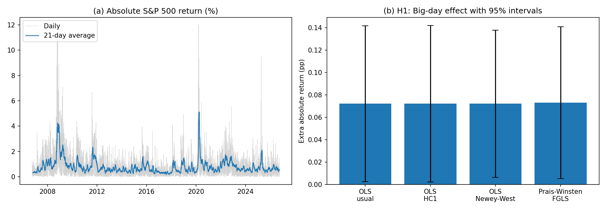

# Big Firm Earnings and the S&P 500

A few firms now carry 1% or more of the S&P 500 each. This project tests whether
their earnings announcements move the index more than announcements by the rest of
the index (H1), whether earnings information predicts daily index direction (H2), and
whether their misses move the index more than their beats (H3). The full write-up,
including method, robustness tests and limitations, is in `Findings.docx`.

## Main results

October 2006 to September 2026, 502 firms, 3,809 earnings days.

- **H1.** Index moves are about 9% larger on days when a Big firm reports. With
  Newey-West errors and market controls the effect is significant (p = 0.025) and
  grows with firm size.
- **H2.** Earnings information does not predict index direction out of sample.
- **H3.** Big misses lower the index while beats do not (p < 0.001), but the data
  cannot separate this asymmetry from the 2008 and 2020 crises.



## Method in brief

A firm is **Big** if its index weight was 1% or more on the trading day before the
market reacts to its announcement, and **Small** otherwise. Weights are approximated
as price times current shares outstanding. Announcements released at or after 4 pm
Eastern time are matched to the next trading day. For each trading day, the script
counts Big and Small reports, sums their index weight, and averages their EPS
surprises.

- **H1** compares the size of index moves on Big days and Small-only days (Welch
  t-test).
- **H2** fits logistic regressions on the first 70% of days and tests them on the last
  30%, against a baseline that always guesses the most common direction.
- **H3** regresses the index return on weight-scaled beats and misses, split by Big
  and Small, and tests whether the Big-miss slope exceeds the Big-beat slope.

An extension re-estimates H1 and H3 with Newey-West standard errors, controls for
market conditions (previous-day VIX and year dummies), a Chow-style test for the 2008
and 2020 crises, and Big cutoffs of 0.5% and 2%, following Wooldridge's
*Introductory Econometrics*.

## Repository

| File | Content |
| :--- | :--- |
| `sp500_big_firm_earnings.py` | The full analysis in one script: download, sample, tests |
| `Findings.docx` | Write-up with all tables and the figure |
| `output/` | Results produced by the script |
| `LICENSE` | MIT |

## Data

All data is public and downloaded by the script on the first run.

| File | Source | Content |
| :--- | :--- | :--- |
| `data/sp500_tickers.csv` | Wikipedia, yfinance | Current members and shares outstanding |
| `data/earnings.csv` | yfinance | Announcement date, hour, EPS surprise (%) |
| `data/prices.csv` | yfinance | Daily closes for all members and ^GSPC |
| `data/vix.csv` | yfinance | Daily VIX close |

The data files are not included in this repository because Yahoo Finance data is
intended for personal use under Yahoo's terms. Running the script downloads them. The
sample window is fixed in the script (`START` and `END`), but the member list, shares
outstanding and earnings history are a snapshot from October 2026 and will differ if
downloaded later.

## How to run

1. Put `sp500_big_firm_earnings.py` in a project folder and set the `PROJECT` line near the
   top to that folder, for example `PROJECT = r"C:\Users\yourname\Desktop\Project"`.
2. Install the packages and run the script (Python 3):
   ```
   pip install pandas numpy matplotlib lxml yfinance scipy statsmodels
   python sp500_big_firm_earnings.py
   ```

The first run downloads the data in a few minutes. Later runs read from `data/` and
finish in seconds. Delete a file in `data/` to download it again.

## Output

| File | Table or figure in `Findings.docx` |
| :--- | :--- |
| `output/h1_abs_return_by_day_type.csv` | Table 1 |
| `output/h2_prediction_results.csv` | Table 3 |
| `output/h3_beat_vs_miss_regression.csv` | First-pass H3 coefficients (Section 3.3) |
| `output/extension_results.csv` | Tables 2 and 4 |
| `output/results.png` | Figure 1 |

The first-pass t-test and the H3 results without 2008 and 2020 are printed to the
console.
